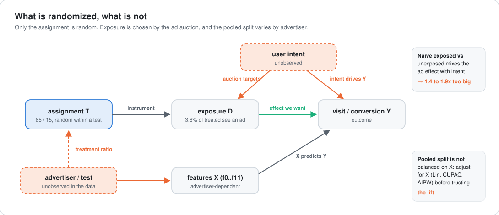
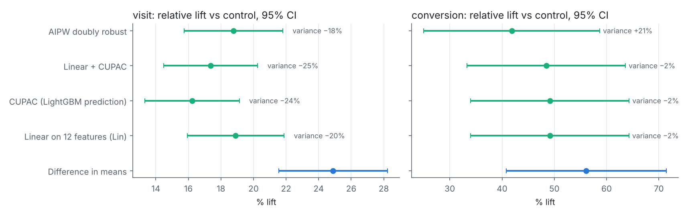
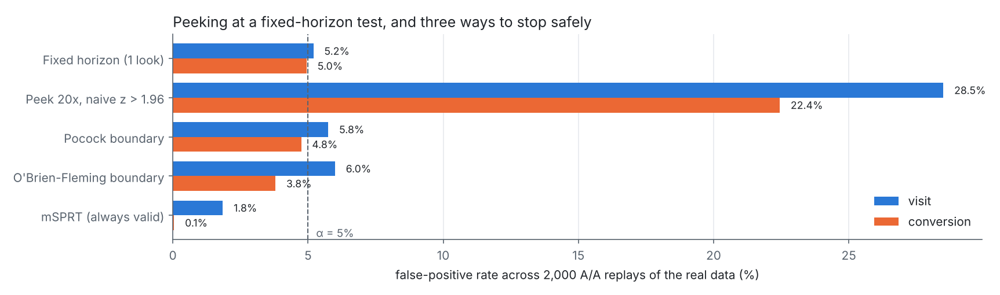
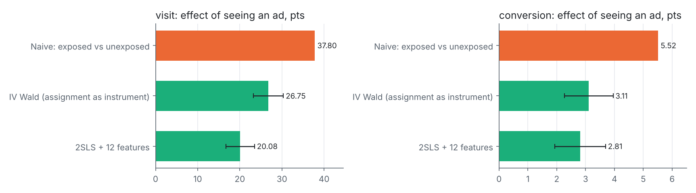

<div align="center">

# Experimentation and Causal Inference Lab

**A decision-grade readout of a real randomized ad experiment: health checks, variance reduction, power, peeking, and the causal effect on users who actually saw an ad.**
<br>Criteo Uplift v2.1 (13.98M users), analysed on a reproducible 5% random sample of 699,009 users.

[](https://github.com/Jitesh-Mishra/ab-testing-causal-lab/actions/workflows/ci.yml)


| **−25%** | **28.5% → 5.8%** | **1.4 to 2.0x** | **4.4 SE** |
|:---:|:---:|:---:|:---:|
| variance of the visit estimate after regression adjustment | false positives when peeking 20x, before → after a Pocock boundary | how much the naive exposed vs unexposed comparison overstates the ad effect | how far the pooled split's imbalance moved the visit lift; caught by the health checks |

</div>

---

## The decision
*Do retargeting ads cause extra visits and conversions for this audience, and what is one ad impression worth?*

Users were randomly assigned to treatment (eligible for ads) or control (withheld) at 85/15. The full readout is [`notebooks/readout.ipynb`](notebooks/readout.ipynb). The metric choices (primary, secondary, guardrails, trade-offs) are in [`docs/metric_design.md`](docs/metric_design.md).

**Recommendation: ship (keep the ads running), conditional on cost.** After correcting for a feature imbalance in the pooled data:
- **Visits:** assignment raises visits by **+0.67 to +0.73 pts (+17 to 19%)**.
- **Conversions:** assignment raises conversions by **+0.084 to +0.097 pts (+42 to 49%)**.
- **Confidence:** every adjusted 95% CI excludes zero.
- **What it does not settle:** the dataset has no spend, so cost per incremental conversion, which is the real ship criterion, is still open.

<picture>
  <source media="(prefers-color-scheme: dark)" srcset="docs/img/causal-dark.svg">
  
</picture>

## 1. Health checks found a problem, and the readout fixes it

| Check | Result | Verdict |
|---|---|---|
| Sample ratio (designed 85%) | 85.09% in the sample (p = 0.036); **85.00%** in the full 13.98M | Not an SRM. Sampling noise, far above the 0.001 alarm level |
| Control users exposed | **0** of 2.1M (full data) | One-sided non-compliance holds, so the IV effect is the effect on the exposed |
| Covariate balance | out-of-fold AUC predicting T from features = **0.508**; standardized mean differences up to **0.046** (13 SE) | **Fails.** Assignment is predictable from features |
| Adjustment on a permuted A/A | shifts the estimate by 0.59 SE (visit) and 0.35 SE (conversion) | As expected under clean randomization |
| Adjustment on the real assignment | shifts the visit estimate by **4.4 SE** (1.0 SE for conversion) | Imbalance, not noise |

Criteo's erratum notes that feature distributions are advertiser-dependent and that incrementality varied across advertisers. The likely cause is that the data pools tests whose setups differ by advertiser. That is a hypothesis, because advertiser id isn't in the data. Either way, the unadjusted difference in means (+25% visits) **overstates** the lift. Three adjusted estimators that rely on different assumptions agree on +16 to 19%.

## 2. Effect and variance reduction

<picture>
  <source media="(prefers-color-scheme: dark)" srcset="reports/figures/effects-dark.png">
  
</picture>

| Outcome | Difference in means | Linear + CUPAC (Lin 2013) | AIPW doubly robust | Variance cut by adjustment |
|---|---:|---:|---:|---:|
| Visit (control 3.87%) | +0.963 pts (+24.9%) | **+0.672 pts (+17.4%)** | +0.726 pts (+18.8%) | **25.0%** |
| Conversion (control 0.200%) | +0.112 pts (+56.1%) | **+0.097 pts (+48.5%)** | +0.084 pts (+41.9%) | 2.0% |

- **The variance reduction is real.** Regressing on the 12 pre-treatment features plus a cross-fitted LightGBM prediction (CUPAC) removes 25% of the visit estimator's variance. That is the same as running the test on a third more users.
- **Conversion barely benefits.** The features predict a 0.2% event poorly, so the cut is 2%. That's the honest result for rare outcomes.
- **AIPW** also models the assignment probability from the features, so it stays valid if the imbalance runs through them. It agrees with Lin within one standard error.

## 3. Power: what this experiment can and cannot detect

| | Visit | Conversion |
|---|---:|---:|
| MDE (80% power, α = 5%), this 699K sample | 4.7% relative (4.1% adjusted) | 21.0% relative |
| MDE, full 13.98M dataset | 1.0% (0.9% adjusted) | 4.7% |
| Users needed to detect a 5% lift | 615K (461K adjusted) | 12.4M |

Conversion is the right primary metric for the decision, but it needs about 20x the traffic of visit to detect the same lift. So visit is the early read, and conversion decides (`reports/power.csv`).

## 4. Peeking

<picture>
  <source media="(prefers-color-scheme: dark)" srcset="reports/figures/peeking-dark.png">
  
</picture>

These are 2,000 A/A replays of the real outcomes with permuted assignment, checked at 20 equally spaced looks. Stopping at the first p < 0.05 declares a winner that doesn't exist **28.5%** (visit) and **22.4%** (conversion) of the time. Pocock and O'Brien-Fleming boundaries (calibrated by simulation) bring that back to 4 to 6%. mSPRT is valid at any stopping time, so with only 20 looks it is conservative (1.8% and under 0.1%). With the real effect, every method detects it. The bootstrap stopping points in `reports/peeking.csv` show a Pocock boundary stops a visit test after about 7% of the traffic, and O'Brien-Fleming after about 17%. Teams evaluate ideas faster *and* stay honest.

## 5. The effect on users who actually saw an ad

<picture>
  <source media="(prefers-color-scheme: dark)" srcset="reports/figures/iv-dark.png">
  
</picture>

Only **3.6%** of treated users were exposed; the auction decides who, and it targets high-intent users. Random assignment is used as an instrument for exposure: the Wald estimator and 2SLS with the features as controls. The first-stage F is about 22,000.

| Outcome | Naive exposed vs unexposed | IV Wald | 2SLS + features | Naive overstates by |
|---|---:|---:|---:|---:|
| Visit | 37.8 pts | 26.8 pts [23.2, 30.3] | 20.1 pts [16.7, 23.5] | **1.4 to 1.9x** |
| Conversion | 5.52 pts | 3.11 pts [2.26, 3.96] | 2.81 pts [1.93, 3.70] | **1.8 to 2.0x** |

A dashboard comparing users who saw ads with those who didn't would credit ads with roughly twice their real effect. Bids priced off that number would overpay. The assumptions are listed in `docs/metric_design.md`. The main weak point is that assignment is not perfectly balanced, which is why the covariate-adjusted 2SLS is the one I'd use.

## Tests: estimators checked against known truth
`pytest -q` runs 9 tests on simulations where the answer is known:
- the difference-in-means CI covers the truth about 95% of the time;
- regression adjustment is unbiased and tighter;
- IV recovers the true effect on the exposed while the naive comparison is biased;
- 2SLS equals Wald without covariates;
- SRM flags a 1-point imbalance;
- the MDE formula delivers 80% power in simulation;
- peeking inflates false positives and all three corrections restore alpha;
- AIPW fixes an assignment that depends on features;
- the regression estimator matches statsmodels' HC2 output to 1e-10.

## Reproduce

```bash
pip install -r requirements.txt
# download criteo-research-uplift-v2.1.csv.gz from https://ailab.criteo.com/criteo-uplift-prediction-dataset/
python scripts/make_sample.py /path/to/criteo-research-uplift-v2.1.csv.gz   # 5% Bernoulli sample, seed 42
PYTHONPATH=src python -m abx.readout          # about 9 min on 2 CPUs (2,000 peeking replays x 4)
python scripts/make_figures.py && python scripts/build_notebook.py
pytest -q
```

The Criteo data is for non-commercial research use and is not redistributed here; every number it produced is in `reports/`. Citation: Diemert, Betlei, Renaudin, Amini, *A Large Scale Benchmark for Uplift Modeling*, AdKDD 2018.

## Limitations
- This is ad data from one research dataset, not product data. The metric design is a documented design, not a live system.
- **The pooled split is imbalanced** on features. The adjusted estimates assume the imbalance runs through the observed features. Advertiser or test id would allow stratifying instead.
- The analysis uses a 5% sample (about 2,000 conversions). The conversion lift is significant, but its size is uncertain (CI roughly ±30% relative).
- There is no spend data, so no cost per incremental conversion, which is the actual ship criterion.
- Peeking is simulated on the real outcomes with permuted assignment, not on a live test's arrival order.

## Next
LightGBM uplift model with a Qini curve against random targeting (who to show ads to), stratified analysis if test ids become available, and the full 14M rows for the conversion readout.

---

<sub>**Stack:** Python, pandas, NumPy, SciPy, statsmodels, LightGBM, matplotlib, Jupyter, pytest. Related: the switchback replay with cluster-robust inference in [nyc-rideshare-pickup-eta](https://github.com/Jitesh-Mishra/nyc-rideshare-pickup-eta).</sub>
